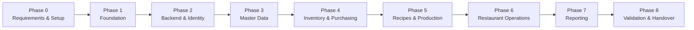

# Albena RMS — Implementation Roadmap (SRS v3.0 Aligned)

**Aligned with**: `docs/SRS_v3.0.md` Section 11, approved 2026-11-17
**Last Updated**: 2026-11-17

---

## Phase Overview

---

## Phase 0 — Requirements & Setup (5%)
**SRS Reference**: Section 11, Phase 0
**Status**: ✅ **COMPLETE** (approved 2026-11-17)

**Scope**:
- Review SRS v3.0, confirm open decisions
- Inspect repository and verify free-tier/no-card constraints
- Establish all mandatory tracking documents
- Create `.gitignore`, `.env.example`

**Exit Condition**: Owner approves requirements baseline and architecture.
**Completed**: 2026-11-17

**Requirements addressed**: CON-01..08, CON-06✅, CON-07(open), ARC-08, ARC-09, DEV-01..08, QTA-01..06, NFR-14, DATA-03..07

---

## Phase 1 — Foundation (10%)
**SRS Reference**: Section 11, Phase 1
**Status**: ✅ **COMPLETE** (2026-11-18)

**Scope**:
- Initialize Vite + React 18 + TypeScript + Tailwind CSS project
- Configure ESLint, Prettier, Vitest
- Set up environment variable handling (`.env.local`, never committed)
- Configure Cloudflare Pages deployment with GitHub CI/CD
- Implement network connectivity error handling
- Verify Supabase and Cloudflare free-tier/no-card eligibility (OD-13)
- Document provider constraints in `docs/DEPLOYMENT.md`

**Exit Condition**: A secure empty application is reachable on Cloudflare Pages.

**Requirements addressed**: ARC-01, ARC-02, ARC-03, ARC-04, ARC-07, NFR-02, NFR-04, NFR-06, NFR-10, NFR-11, AC-15, AC-17, AC-18

---

## Phase 2 — Backend & Identity (10%)
**SRS Reference**: Section 11, Phase 2
**Status**: ✅ **COMPLETE** (2026-11-18) — schema, RLS and administrator authentication verified live.
⚠️ **AC-01 remains unverified**: only the administrator account exists, so "three test users authenticate" has not been demonstrated.

**Scope**:
- Supabase project initialization and schema migration setup
- Database foundation: `user_profiles`, `roles`, `permissions`, `audit_logs`
- Supabase Auth integration with individual user accounts
- PostgreSQL RLS policies: auth, outlet isolation, role enforcement
- Audit trigger functions (append-only audit log)
- Three test user accounts provisioned and tested

**Exit Condition**: Three test users authenticate and authorization tests pass (AC-01, AC-02).

**Delivered**: `roles`, `user_profiles`, `user_roles`, `outlets`, `user_outlet_scopes`, `audit_logs`; RLS on all six tables; `SECURITY DEFINER` policy helpers; append-only audit triggers; new-user profile trigger; admin RPCs; login/logout/disabled-account UI. Owner applied both migrations and verified the administrator login, role and five outlet scopes.

**Requirements addressed**: SEC-ROLE-01..06, ARC-05, ARC-06, USR-01..05, OUT-04, AUD-01..05, NFR-01, NFR-05..09, AC-01, AC-02, AC-13, AC-17

**Open acceptance item**: create the two remaining test accounts, then record AC-01 and AC-02 results. OD-02 and OD-03 are resolved.

---

## Phase 3 — Master Data (10%)
**SRS Reference**: Section 11, Phase 3
**Status**: ✅ **COMPLETE** — master-data CRUD, unit conversions, categories and user/role/outlet administration delivered and tested.

**Scope**:
- ✅ Outlet management UI: list, create, edit, deactivate/reactivate (no deletes)
- ✅ Supplier management UI: list, create, edit, deactivate/reactivate (no deletes)
- ✅ Item master UI: list, create, edit, deactivate/reactivate; category, base unit, optional purchase unit, reorder level
- ✅ Stock-location management UI: list, create, edit, deactivate/reactivate (no deletes)
- ✅ Item unit-conversion editor (box / carton / sack factors, created + edit factor, per item)
- ✅ Category management UI: list, create, edit, deactivate/reactivate (no deletes), mounted on `/inventory`
- ✅ User management UI: list profiles, disable/reactivate, assign roles, grant/revoke outlet access (admin only)

**Exit Condition**: Master data CRUD and access scopes pass tests.

**Delivered so far**:
- Migrations `20261118000300_master_data.sql` and `20261118000400_master_data_seed.sql` **applied**: `stock_locations`, `item_categories`, `units`, `item_unit_conversions`, `suppliers`, `items`, RLS, audit triggers, reference seeds. Verified: all six tables respond to REST; anon writes return `42501`.
- Settings page at `/settings` with the outlet panel (admin-only writes, matching the policy).
- Purchasing page at `/purchasing` with the supplier panel (admin / GM / purchasing officer).
- Inventory page at `/inventory` with the item panel, the category panel and the stock-location panel, each gated by its own RLS-backed write policy; the stock ledger section states plainly that no balances or movements exist yet.
- Settings page at `/settings` also hosts the user administration panel: account status through `admin_set_user_status()`, role assignment through `admin_assign_role()`, and per-outlet access through `user_outlet_scopes` (admin-only writes, enforced by RLS and the RPC checks).
- Shared Postgres error mapping (`src/lib/errors.ts`), including a clear message when a table is missing because a migration has not been applied.
- FE tests cover list, load failure, create, validation, edit, deactivate and read-only roles for outlets, suppliers, items, categories and locations; item tests cover base-unit creation and purchase-unit factor recording.

**Requirements addressed**: OUT-01..03, SUP-01..02, INV-01..05, USR-01..05, SEC-ROLE-05

**Depends on**: owner applying migrations 0003 and 0004 before suppliers, items and locations can be used. OD-01, OD-02 and OD-05 are resolved (ADR-010).

---

## Phase 4 — Inventory & Purchasing (20%)
**SRS Reference**: Section 11, Phase 4
**Status**: ✅ **Build complete** — all Phase 4 workflows delivered; live AC-06/AC-07 verification deferred to final UAT

**Delivered (2026-11-18)**:
- Goods Receiving Notes (GRN) with atomic stock increase, FIFO layer creation and duplicate-posting protection
- Store Issue Vouchers (SIV) with atomic source/destination update and FIFO consumption
- Stock ledger engine (append-only transactions, derived balances, movement history)
- Base-unit conversion resolution in the database (ADR-010)
- Purchase Requests: header/lines, Draft → Submitted → Approved/Rejected, approver + time + comment recorded
- Purchase Orders: header/lines with unit costs, Draft → Approved → Ordered → Closed, one order per approved request
- PROCUREMENT role gates: `system_admin`/`general_manager`/`purchasing_officer` manage; `system_admin`/`general_manager` approve
- GRN ↔ PO linkage: optional `po_id`/`po_line_id`, outstanding-line seeding, supplier lock, and a derived `purchase_order_receipts` view with `pending`/`partial`/`complete`/`over` status from posted GRNs only
- AC-03 verified live: PR approval recorded, PO created and closed, purchasing officer blocked from approving
- AC-04, AC-05 and GRN-04 verified against the live database by the owner (GRN 2,000 g / ETB 240.00 → SIV 500 g / ETB 180.00; over-receipt recorded as `over`)
- Inventory counts: base-unit count sheets with a ledger snapshot, generated variance, submit/review/approve then posting that reconciles the ledger to the physical quantity through `adjustment` transactions (CNT-01..05, STK-04)
- Adjustments: increase/decrease documents with SRS reasons, one-shot approval and FIFO posting (ADJ-01..03)
- Waste: item, quantity, location, date, user and reason, approved and posted as a FIFO decrease (WST-01..03)
- Reorder alerts: total on-hand across locations compared with the item-level reorder level (INV-06)
- Migration `20261118000800_counts_adjustments_waste.sql` **applied by owner and structure-verified** (six objects present, anon denied, eight RPCs role-gated)

**Remaining**:
- Final UAT: AC-06 (count variance → approved posting reconciles the ledger) and AC-07 (waste decreases inventory at FIFO cost); owner deferred detailed testing to the end of the project

**Scope**:
- Purchase Request workflow (Draft → Submitted → Approved/Rejected → PO)
- Purchase Order management
- Goods Receiving Notes (GRN) with atomic stock increase and valuation update
- Store Issue Vouchers (SIV) with atomic source/destination update
- Stock ledger engine (transaction-based balances)
- Inventory counting module with variance calculation and approval
- Inventory adjustments (approved reasons, audit-trailed)
- Waste recording and posting
- Low-stock/reorder alert system

**Exit Condition**: Stock ledger and reconciliation tests pass (AC-03..07). AC-03, AC-04, AC-05 and GRN-04 are verified live; counts, adjustments and waste are built, unit-tested and structurally verified, with AC-06/AC-07 live checks deferred to final UAT.

**Requirements addressed**: PR-01..04, PO-01..04, GRN-01..05, SIV-01..05, STK-01..07, CNT-01..05, ADJ-01..03, WST-01..04, INV-04, INV-06

**Decisions**: OD-04 FIFO (ADR-009), OD-05 unit model (ADR-010) and inventory control (ADR-011) confirmed 2026-11-18. OD-06 approval thresholds remain undefined: postings are role-gated and record who acted; PR/PO and inventory-document approval is limited to System Administrator/General Manager, self-approval is not blocked, and no monetary thresholds exist.

---

## Phase 5 — Recipes & Production (10%)
**SRS Reference**: Section 11, Phase 5
**Status**: ✅ **Build complete** — migration 0009 applied and verified; final UAT deferred

**Scope**:
- Recipe management (ingredients, quantities, yield, version history)
- Food cost calculation engine (Food Cost % = Cost ÷ Price × 100)
- Production order recording (raw → semi/finished goods)
- Atomic production posting (consume inputs, produce outputs)
- Theoretical consumption baseline for variance reporting

**Delivered (2026-11-18)**:
- `recipes`, immutable `recipe_versions` and `recipe_version_lines`; drafts append a version, publishing archives the previous published version (REC-01, REC-02)
- `recipe_version_costs` view derives total cost, cost per portion, gross profit and food cost % from the current FIFO weighted-average ingredient cost across locations (REC-03, REC-04)
- Recipe definitions never touch stock (REC-06); menu item remains text until the Phase 6 menu entity exists
- `production_orders` and `production_inputs` with actual output, optional expected output, generated yield %, responsible user, date and location (PROD-01, PROD-02)
- `post_production_order()` consumes every input through FIFO and creates the output layer at the consumed cost in one transaction (PROD-03, PROD-04, STK-02/03)
- `/kitchen` page with the Recipes and Production panels, plus validation, role gates, read-only states and refresh/confirm flows
- Tests: `recipesValidation.test.ts` (16) and `Kitchen.test.tsx` (8)
- Migration `20261118000900_recipes_production.sql` applied by the owner; all six objects and nine RPCs verified through PostgREST (anon denied with `42501`)

**Remaining**:
- Final UAT: AC-07 production posting and AC-08 costing (deferred by the owner with the rest of UAT)
- REC-05 and REC-07 theoretical consumption need Phase 6 sales (COST-01..03 in Phase 7)

**Exit Condition**: Costing and production calculations pass (AC-07, AC-08, AC-09). Build and unit tests are complete; AC-07/AC-08 live checks are deferred to final UAT and AC-09 remains partial until Phase 6.

**Requirements addressed**: REC-01..07, PROD-01..04, COST-01..03

**Decisions**: consumes FIFO layer costs (ADR-009) in base units (ADR-010); recipe versioning, costing and production posting recorded in ADR-012.

---

## Phase 6 — Restaurant Operations (15%)
**SRS Reference**: Section 11, Phase 6
**Status**: ✅ **Build complete** — migrations 0010/0011 applied and verified; final UAT deferred

**Scope**:
- Menu management (items, categories, pricing, deactivation)
- Table layout and status management
- Reservation workflow (Booked → Confirmed → Arrived → Cancelled/Completed)
- Order taking (open, modify, cancel, transfer, split, close)
- Kitchen Display System (KDS) with Supabase Realtime
- Receipt generation (browser print + PDF)
- Price snapshot preservation at order close

**Delivered (2026-11-18)**:
- `business_settings`, `menu_categories`, `menu_items`, `restaurant_tables`, `reservations`, `document_sequences`, `orders`, `order_lines`, `receipts`, the `reservation_slot_load` view, eight role helpers and fifteen SECURITY DEFINER RPCs (migration 0010)
- Menu: categories with sort order and items with code, name, category, VAT-inclusive selling price, optional recipe link and active flag; deactivation preserves order history (MENU-01..03)
- Tables: outlet, code, name, capacity, active flag and status, with state advancing automatically from orders and reservations (TBL-01, TBL-02)
- Reservations: guest name/phone, party size, date/time and optional table; `booked → confirmed → arrived → cancelled/completed`; exact-slot double-booking blocked and overbooking warned from `reservation_slot_load` (RES-01, RES-02, RES-04; RES-03 dropped per OD-10)
- Orders: lifecycle `pending → sent_to_kitchen → preparing → ready → served → closed` plus `cancelled`; create, edit, send, serve, cancel, transfer, split, manager merge and close all run atomically in SQL (ORD-01..04, ORD-06)
- Line price snapshots: code, name and unit price are copied at line creation, so later menu edits cannot rewrite history (ORD-03, RCT-05)
- Revision-based optimistic concurrency with SQLSTATE `40001` and a visible conflict message (ORD-05)
- Closing requires `served`, extracts VAT from VAT-inclusive totals as `total × rate ÷ (100 + rate)`, issues an immutable receipt and frees the table (RCT-01, RCT-03, OD-07)
- Receipt numbering `<OUTLET>-YYYYMMDD-####` per outlet per business day via `document_sequences`; identity, VAT rate and footer are snapshotted onto the receipt (OD-08)
- Kitchen display: Sent/Preparing/Ready columns, sent/opened timestamps, line instructions, role-gated transitions and Realtime refetch on `orders`/`order_lines` changes (KDS-01..03); online only (KDS-05). KDS-01 is partial: timestamps are shown, but there is no elapsed-minutes counter
- Receipt view supports browser print, giving the print/PDF output path without a client-side PDF library (RCT-02)
- `/operations` page with `MenuPanel`, `TablesPanel`, `ReservationsPanel`, `OrdersPanel` and `KitchenDisplayPanel`; `BusinessSettingsPanel` mounted on `/settings`
- Role gates mirror the SRS table: menu/layout = admin/GM/RM; table status = +waiter/cashier; reservations/orders = +waiter; kitchen status = +executive chef/kitchen staff; close = admin/GM/RM/cashier; business settings = admin/GM
- Tests: `menuValidation.test.ts`, `tablesReservationsValidation.test.ts`, `ordersValidation.test.ts` (10), `Operations.test.tsx` (11) and `Settings.test.tsx` (12); full suite 252/252 across 28 suites
- Commits `ac31955` (slice 1) and `3ed1273` (slice 2) pushed to `main`; Cloudflare serves `assets/index-fqmOEPuP.js` (811,382 bytes)
- Migrations 0009 and 0010 applied by the owner and verified through PostgREST: all 16 objects and 33 RPCs resolve; anon is denied with `42501`, not `404`
- Verification gap: the applied 0010 predated the receipt-footer snapshot, so `receipts.receipt_footer` was missing. Hotfix `20261118001100_receipt_footer_and_function_privileges.sql` added it, recreated `close_order()`, and revoked anonymous EXECUTE on ungated helpers; applied 2026-11-19 and re-verified

**Remaining**:
- Final UAT: AC-10 (KDS flow), AC-11 (order/table workflow), AC-14 (concurrent table/order handling) and AC-15 (reservations), deferred by the owner with the rest of UAT
- KDS-04 prep-time reporting and the Phase 7 reservation/guest-history reports remain in Phase 7
- Outlet scoping of stock/recipes still needs the `stock_locations` ↔ outlet decision; Phase 6 reads are role-based

**Exit Condition**: Three-user live workflows pass (AC-10, AC-11, AC-14, AC-15). Build and unit tests are complete; live runs are deferred to final UAT.

**Requirements addressed**: MENU-01..03, TBL-01..04, RES-01, RES-02, RES-04, ORD-01..06, KDS-01..03, KDS-05, RCT-01..05, NFR-03

**Decisions**: OD-07 (VAT 15%, inclusive prices, no service charge/discounts), OD-08 (receipt numbering and editable identity), OD-09 (optional table, exact-slot block, overbooking warning), OD-10 (no guest profiles) and OD-12 (hotel features deferred) resolved 2026-11-18; recorded with the full operational model in ADR-013. OD-06 thresholds and separation of duties remain open.

---

## Phase 7 — Reporting (10%)
**SRS Reference**: Section 11, Phase 7
**Status**: ✅ Build complete and structure-verified — migration `20261118001200_reporting.sql` applied 2026-11-19; AC-12 live reconciliation at final UAT

**Scope**:
- Sales reports (daily, monthly, outlet, category, item, waiter) from immutable receipts, with a sold-lines vs receipt-net-sales reconciliation
- Inventory reports (stock on hand, FIFO valuation, reorder status, days since last movement; the slow/dead threshold is chosen in the UI, not invented)
- Purchasing reports (PR, PO, GRN with ordered vs posted received value)
- Cost reports (theoretical consumption and variance using the current published recipe and current FIFO average cost)
- Waste reports and trends from posted waste lines
- KDS / kitchen timing reports (delayed-ticket threshold is a UI filter, default 20 minutes)
- Reservation summaries (guest history dropped per OD-10)
- Management dashboard (KPIs: today's sales, kitchen queue, open tables, low stock, inventory value, top items, food cost %, waste %, reservations)
- Shared date and outlet filters on `/reports`; inventory, purchasing and waste are labelled company-wide until stock locations are mapped to outlets

**Delivered**: eleven `security_invoker` views in migration 0012 (anon denied with `42501`, `authenticated` select only), typed report loaders, `/reports` with six sections, rebuilt `/dashboard`, and 14 new/updated tests. Build committed as `63115ba` and deployed; all eleven views resolved through PostgREST after the owner applied 0012.

**Exit Condition**: Report totals reconcile to test data (AC-12) — pending final UAT.

**Requirements addressed**: RPT-01..09, COST-01..03, SUP-03, CNT-04, WST-04, KDS-04

---

## Phase 8 — Validation & Handover (10%)
**SRS Reference**: Section 11, Phase 8
**Status**: ⏳ Planned

**Scope**:
- Full security review (secrets, RLS, injection, broken access control)
- Three-user concurrent end-to-end acceptance test across separate locations
- Backup/export procedure documented and tested (DATA-03..07)
- Restore test in Supabase if supported free
- Performance test: <2s p95 response (NFR-03)
- Final documentation: `docs/DEPLOYMENT.md`, `docs/TESTING.md`
- Owner demo and prototype acceptance

**Exit Condition**: Owner accepts prototype test results and known limitations (AC-01..AC-19).

**Requirements addressed**: AC-01..19, NFR-01..14, DATA-01..07, ARC-09

---

## Completion Calculation

| Phase | Weight | Status | Credit |
|:---|:---:|:---:|:---:|
| Phase 0 | 5% | ✅ Complete | 5.0% |
| Phase 1 | 10% | ✅ Complete | 10.0% |
| Phase 2 | 10% | ✅ Complete | 10.0% |
| Phase 3 | 10% | ✅ Complete | 10.0% |
| Phase 4 | 20% | ✅ Build complete — final UAT deferred | 0% (releases at final UAT) |
| Phase 5 | 10% | 🚧 Build complete — final UAT deferred | 0% (releases at final UAT) |
| Phase 6 | 15% | ✅ Build complete — final UAT deferred | 0% (releases at final UAT) |
| Phase 7 | 10% | ✅ Build complete and structure-verified — AC-12 deferred | 0% (releases at final UAT) |
| Phase 8 | 10% | ⏳ Planned | 0% |
| **Total** | **100%** | | **35.0%** |
