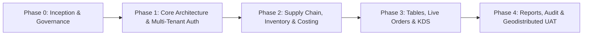

# Albena RMS — Implementation Roadmap

## 1. Roadmap Overview & Strategic Objectives

The Albena Restaurant Management System (RMS) is designed as a cloud-native, multi-branch, web-based prototype capable of supporting concurrent operation across **three geographically separated users** (e.g., Branch Manager, Head Chef/Storekeeper, Cashier/Server).

To safeguard AI quotas and guarantee architectural integrity, development proceeds strictly through verifiable, gate-controlled milestones.

---

## 2. Phased Milestone Breakdown

### Phase 0: Inception, Governance & Requirements Discovery (Milestones M0–M1)
- **Objective**: Establish development standards, security guardrails, AI quota monitoring, and SRS traceability.
- **Key Deliverables**:
  - `M0`: Governance framework (`PROJECT_STATUS.md`, `ROADMAP.md`, `QUOTA_LOG.md`, `.gitignore`, `.env.example`).
  - `M1`: Ingest and analyze authoritative Software Requirements Specification (SRS), establishing initial requirement matrix in `docs/REQUIREMENTS_TRACEABILITY.md`.
- **Exit Gate**: Owner signs off on Roadmap and provides official SRS.

---

### Phase 1: Core Architecture, Multi-Tenant Hierarchy & 3-User Auth (Milestones M2–M3)
- **Objective**: Establish client application skeleton, cloud database schema, authentication, and security policies.
- **Key Deliverables**:
  - `M2`:
    - Vite + React + TypeScript + Tailwind CSS project initialization.
    - Cloudflare Pages configuration & CI/CD workflow.
    - Supabase PostgreSQL schema for Organization, Restaurant, Branch, and Outlets.
  - `M3`:
    - Supabase Auth integration (Email/Password & Session Management).
    - Role-Based Access Control (RBAC) supporting at least 3 distinct personas:
      1. **Administrator / General Manager** (Full control, reporting, audit).
      2. **Inventory Controller / Head Chef** (Stock, SIV, GRN, Recipes).
      3. **Floor Supervisor / Cashier** (Tables, Orders, POS, KDS).
    - PostgreSQL Row-Level Security (RLS) policies enforcing multi-branch isolation. No frontend-only security.
- **Exit Gate**: 3 separate users successfully authenticate from different sessions and confirm RLS boundaries.

---

### Phase 2: Supply Chain, Inventory, SIV, GRN & Recipe Costing (Milestones M4–M5)
- **Objective**: Build end-to-end stock and supply operations with accurate financial costing.
- **Key Deliverables**:
  - `M4`:
    - Item master (raw materials, consumables, units of measure, conversions).
    - Suppliers and purchase order tracking.
    - Goods Received Notes (GRN) with stock level recalculation and moving average cost.
    - Stock Issue Vouchers (SIV) for department/kitchen requisitions.
    - Real-time stock balance and low-stock alerts.
  - `M5`:
    - Recipe engineering module with Bill of Materials (BOM).
    - Portion sizing, theoretical food costing, and profit margin analysis.
    - Menu item management, category taxonomy, and pricing engine.
- **Exit Gate**: Simulated GRN intake updates stock quantities and recipe food costs propagate accurately.

---

### Phase 3: Tables, Real-Time Ordering, POS & Kitchen Display (Milestones M6–M7)
- **Objective**: Implement frontline dining and order management with live synchronization across locations.
- **Key Deliverables**:
  - `M6`:
    - Visual floor and table layout management per outlet.
    - Table status tracking (Available, Occupied, Billed, Reserved).
    - Table reservations and customer party details.
  - `M7`:
    - Fast POS order entry interface optimized for touch/keyboard.
    - Modifiers, special instructions, and split/merge bills.
    - Kitchen Display System (KDS) powered by Supabase Realtime subscriptions.
    - Kitchen order ticket (KOT) workflow: New $\rightarrow$ In Preparation $\rightarrow$ Ready $\rightarrow$ Served.
- **Exit Gate**: Concurrent live test: User A places order from Location 1; User B sees KDS update instantly at Location 2.

---

### Phase 4: Financial Analytics, Audit Trails & 3-User Acceptance Testing (Milestones M8–M9)
- **Objective**: Provide executive reporting, complete audit compliance, and validate multi-location prototype readiness.
- **Key Deliverables**:
  - `M8`:
    - Comprehensive audit trail table tracking all critical mutations (who, when, what, previous/new value).
    - Sales reports (daily reconciliation, item sales velocity, category mix).
    - Inventory reconciliation reports (stock variance, shrinkage, food cost variance).
    - Executive dashboard with key performance indicators (RevPASH, average check, gross margin).
  - `M9`:
    - Cloudflare Pages production deployment on free tier.
    - Structured 3-user User Acceptance Testing (UAT) protocol across 3 distinct physical/geographical connections.
    - Handover documentation, architecture guides, and runbooks.
- **Exit Gate**: Successful end-to-end business cycle executed simultaneously by 3 remote testers with zero data collisions.

---

## 3. Technology Stack Reference

| Layer | Component | Target Version / Provider | Free Tier Compliance |
| :--- | :--- | :--- | :--- |
| **Frontend Framework** | React 18+ / TypeScript / Vite | Modern ESM | Free Open Source |
| **Styling & UI Components**| Tailwind CSS + Lucide React | Modern Tailwind v3/v4 | Free Open Source |
| **Backend / Database** | PostgreSQL 15+ | Supabase Cloud | Free Tier (500MB DB, 50k MAU) |
| **Authentication** | Supabase Auth (JWT) | Supabase Auth | Included in Free Tier |
| **Realtime Sync** | Supabase Realtime (WebSockets) | Supabase Realtime | Included in Free Tier |
| **Authorization** | PostgreSQL Row Level Security | Native Postgres RLS | Native engine feature |
| **Hosting & CDN** | Cloudflare Pages | Cloudflare | Free Tier (Unlimited bandwidth) |
| **Source Control** | GitHub Public Repo | GitHub | Free Public Repository |
