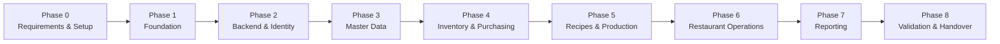

# Albena RMS — Implementation Roadmap (SRS v3.0 Aligned)

**Aligned with**: `docs/SRS_v3.0.md` Section 11, approved 2026-11-17
**Last Updated**: 2026-11-17

---

## Phase Overview

---

## Phase 0 — Requirements & Setup (5%)
**SRS Reference**: Section 11, Phase 0
**Status**: ✅ **COMPLETE** (approved 2026-11-17)

**Scope**:
- Review SRS v3.0, confirm open decisions
- Inspect repository and verify free-tier/no-card constraints
- Establish all mandatory tracking documents
- Create `.gitignore`, `.env.example`

**Exit Condition**: Owner approves requirements baseline and architecture.
**Completed**: 2026-11-17

**Requirements addressed**: CON-01..08, CON-06✅, CON-07(open), ARC-08, ARC-09, DEV-01..08, QTA-01..06, NFR-14, DATA-03..07

---

## Phase 1 — Foundation (10%)
**SRS Reference**: Section 11, Phase 1
**Status**: ✅ **COMPLETE** (2026-11-18)

**Scope**:
- Initialize Vite + React 18 + TypeScript + Tailwind CSS project
- Configure ESLint, Prettier, Vitest
- Set up environment variable handling (`.env.local`, never committed)
- Configure Cloudflare Pages deployment with GitHub CI/CD
- Implement network connectivity error handling
- Verify Supabase and Cloudflare free-tier/no-card eligibility (OD-13)
- Document provider constraints in `docs/DEPLOYMENT.md`

**Exit Condition**: A secure empty application is reachable on Cloudflare Pages.

**Requirements addressed**: ARC-01, ARC-02, ARC-03, ARC-04, ARC-07, NFR-02, NFR-04, NFR-06, NFR-10, NFR-11, AC-15, AC-17, AC-18

---

## Phase 2 — Backend & Identity (10%)
**SRS Reference**: Section 11, Phase 2
**Status**: ✅ **COMPLETE** (2026-11-18) — schema, RLS and administrator authentication verified live.
⚠️ **AC-01 remains unverified**: only the administrator account exists, so "three test users authenticate" has not been demonstrated.

**Scope**:
- Supabase project initialization and schema migration setup
- Database foundation: `user_profiles`, `roles`, `permissions`, `audit_logs`
- Supabase Auth integration with individual user accounts
- PostgreSQL RLS policies: auth, outlet isolation, role enforcement
- Audit trigger functions (append-only audit log)
- Three test user accounts provisioned and tested

**Exit Condition**: Three test users authenticate and authorization tests pass (AC-01, AC-02).

**Delivered**: `roles`, `user_profiles`, `user_roles`, `outlets`, `user_outlet_scopes`, `audit_logs`; RLS on all six tables; `SECURITY DEFINER` policy helpers; append-only audit triggers; new-user profile trigger; admin RPCs; login/logout/disabled-account UI. Owner applied both migrations and verified the administrator login, role and five outlet scopes.

**Requirements addressed**: SEC-ROLE-01..06, ARC-05, ARC-06, USR-01..05, OUT-04, AUD-01..05, NFR-01, NFR-05..09, AC-01, AC-02, AC-13, AC-17

**Open acceptance item**: create the two remaining test accounts, then record AC-01 and AC-02 results. OD-02 and OD-03 are resolved.

---

## Phase 3 — Master Data (10%)
**SRS Reference**: Section 11, Phase 3
**Status**: 🟡 **IN PROGRESS** — outlet management delivered; suppliers, items, stock locations and user administration pending.

**Scope**:
- ✅ Outlet management UI: list, create, edit, deactivate/reactivate (no deletes)
- Business workspace, outlets and location management UI
- Supplier management (create, edit, deactivate)
- Inventory item master (create, edit, categories, deactivate)
- Stock location management
- User management UI (assign roles, outlet scopes, disable/reactivate)

**Exit Condition**: Master data CRUD and access scopes pass tests.

**Delivered so far**:
- Migrations `20261118000300_master_data.sql` and `20261118000400_master_data_seed.sql` authored: `stock_locations`, `item_categories`, `units`, `item_unit_conversions`, `suppliers`, `items`, RLS, audit triggers, reference seeds. **Not yet applied.**
- Settings page at `/settings` with the outlet panel: RLS-gated write controls, client validation, duplicate-code and permission error mapping, deactivate instead of delete.
- FE tests cover list, load failure, create, validation, edit, deactivate and read-only roles.

**Requirements addressed**: OUT-01..03, SUP-01..02, INV-01..05, USR-01..05, SEC-ROLE-05

**Depends on**: owner applying migrations 0003 and 0004 before suppliers, items and locations can be used. OD-01, OD-02 and OD-05 are resolved (ADR-010).

---

## Phase 4 — Inventory & Purchasing (20%)
**SRS Reference**: Section 11, Phase 4
**Status**: ⏳ Planned

**Scope**:
- Purchase Request workflow (Draft → Submitted → Approved/Rejected → PO)
- Purchase Order management
- Goods Receiving Notes (GRN) with atomic stock increase and valuation update
- Store Issue Vouchers (SIV) with atomic source/destination update
- Stock ledger engine (transaction-based balances)
- Inventory counting module with variance calculation and approval
- Inventory adjustments (approved reasons, audit-trailed)
- Waste recording and posting
- Low-stock/reorder alert system

**Exit Condition**: Stock ledger and reconciliation tests pass (AC-03..07).

**Requirements addressed**: PR-01..04, PO-01..04, GRN-01..05, SIV-01..05, STK-01..07, CNT-01..05, ADJ-01..03, WST-01..04, INV-04, INV-06

**Decisions**: OD-04 FIFO (ADR-009) and OD-05 unit model (ADR-010) both confirmed 2026-11-18.

---

## Phase 5 — Recipes & Production (10%)
**SRS Reference**: Section 11, Phase 5
**Status**: ⏳ Planned

**Scope**:
- Recipe management (ingredients, quantities, yield, version history)
- Food cost calculation engine (Food Cost % = Cost ÷ Price × 100)
- Production order recording (raw → semi/finished goods)
- Atomic production posting (consume inputs, produce outputs)
- Theoretical consumption baseline for variance reporting

**Exit Condition**: Costing and production calculations pass (AC-07, AC-08, AC-09).

**Requirements addressed**: REC-01..07, PROD-01..04, COST-01..03

**Decisions**: consumes FIFO layer costs (ADR-009) in base units (ADR-010).

---

## Phase 6 — Restaurant Operations (15%)
**SRS Reference**: Section 11, Phase 6
**Status**: ⏳ Planned

**Scope**:
- Menu management (items, categories, pricing, deactivation)
- Table layout and status management
- Reservation workflow (Booked → Confirmed → Arrived → Cancelled/Completed)
- Order taking (open, modify, cancel, transfer, split, close)
- Kitchen Display System (KDS) with Supabase Realtime
- Receipt generation (browser print + PDF)
- Price snapshot preservation at order close

**Exit Condition**: Three-user live workflows pass (AC-10, AC-11, AC-14, AC-15).

**Requirements addressed**: MENU-01..03, TBL-01..04, RES-01..04, ORD-01..06, KDS-01..05, RCT-01..05, NFR-03

**Blocked by**: OD-07 (taxes/discounts), OD-08 (receipt format), OD-09 (reservation rules), OD-10 (guest profiles), OD-12 (hotel features scope)

---

## Phase 7 — Reporting (10%)
**SRS Reference**: Section 11, Phase 7
**Status**: ⏳ Planned

**Scope**:
- Sales reports (daily, monthly, outlet, category, waiter)
- Inventory reports (stock on hand, movement, valuation, slow-moving)
- Purchasing reports (PR, PO, GRN)
- Cost reports (recipe cost, food cost %, profitability)
- Waste reports and trends
- KDS / kitchen timing reports
- Reservation reports and guest history
- Management dashboard (KPIs: open tables, kitchen queue, low-stock, top items, food cost %, waste %)
- All reports respect outlet scope and show applied filters

**Exit Condition**: Report totals reconcile to test data (AC-12).

**Requirements addressed**: RPT-01..09, COST-01..03, SUP-03, CNT-04, WST-04, KDS-04

---

## Phase 8 — Validation & Handover (10%)
**SRS Reference**: Section 11, Phase 8
**Status**: ⏳ Planned

**Scope**:
- Full security review (secrets, RLS, injection, broken access control)
- Three-user concurrent end-to-end acceptance test across separate locations
- Backup/export procedure documented and tested (DATA-03..07)
- Restore test in Supabase if supported free
- Performance test: <2s p95 response (NFR-03)
- Final documentation: `docs/DEPLOYMENT.md`, `docs/TESTING.md`
- Owner demo and prototype acceptance

**Exit Condition**: Owner accepts prototype test results and known limitations (AC-01..AC-19).

**Requirements addressed**: AC-01..19, NFR-01..14, DATA-01..07, ARC-09

---

## Completion Calculation

| Phase | Weight | Status | Credit |
|:---|:---:|:---:|:---:|
| Phase 0 | 5% | ✅ Complete | 5.0% |
| Phase 1 | 10% | ✅ Complete | 10.0% |
| Phase 2 | 10% | 🟡 In Progress | 0% |
| Phase 3 | 10% | ⏳ Planned | 0% |
| Phase 4 | 20% | ⏳ Planned | 0% |
| Phase 5 | 10% | ⏳ Planned | 0% |
| Phase 6 | 15% | ⏳ Planned | 0% |
| Phase 7 | 10% | ⏳ Planned | 0% |
| Phase 8 | 10% | ⏳ Planned | 0% |
| **Total** | **100%** | | **15.0%** |
